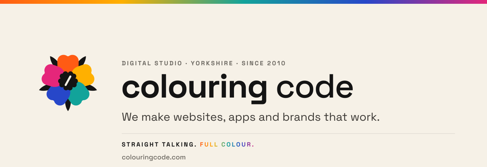
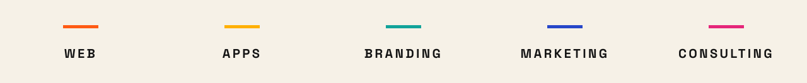

<picture>
  <source media="(prefers-color-scheme: dark)" srcset="https://raw.githubusercontent.com/colouringcode/.github/main/profile/assets/banner-dark.svg">
  
</picture>

  Planned, built and looked after by the same pair of hands since 2010 — 
  from first conversation to aftercare.

  <a href="https://www.colouringcode.com"><b>colouringcode.com</b></a>
  &nbsp;·&nbsp;
  <a href="https://www.colouringcode.com/work">Work</a>
  &nbsp;·&nbsp;
  <a href="https://www.colouringcode.com/insights">Insights</a>
  &nbsp;·&nbsp;
  <a href="mailto:team@colouringcode.com">team@colouringcode.com</a>
  &nbsp;·&nbsp;
  <a href="https://www.linkedin.com/company/colouringcode">LinkedIn</a>

## What we're best at

Taking a website that's holding a business back and turning it into one that brings work in — for owner-run businesses in Yorkshire and the UK.

A stale site, a launch coming up, or a job that keeps eating your time. If you need a 50-person agency, we're not it.

<a href="https://www.colouringcode.com/services">
  <picture>
    <source media="(prefers-color-scheme: dark)" srcset="https://raw.githubusercontent.com/colouringcode/.github/main/profile/assets/disciplines-dark.svg">
    
  </picture>
</a>

## Selected work

**[Sitwell Cycling Club](https://www.colouringcode.com/work/sitwell-cycling-club)** — brand, website, kit and marketing, 2016–Present.
From one ride in 2016 to nine a week and 200-plus members, with one studio behind the crest, the kit and the site.

**[Field Kit](https://www.colouringcode.com/work/field-kit)** — iOS and Android first aid reference.
Offline-first guidance, defibrillator data and an offline map for remote, low-signal places, and an identity drawn from the map itself.

**[EA Signs](https://www.colouringcode.com/work/ea-signs)** — brand and client portal.
From a whiteboard and the phone to agents booking and tracking every board themselves, with the vans, the site and the portal looking like one company.

**[Meliora](https://www.colouringcode.com/work/meliora)** — consulting since 2017.
Marketing, the broadband it runs on and a website rework — someone sensible on the other end of the phone.

  <b>Got a project?</b> <a href="https://www.colouringcode.com/contact">Let's talk.</a>

  Based in Yorkshire. Working with businesses across the UK.

